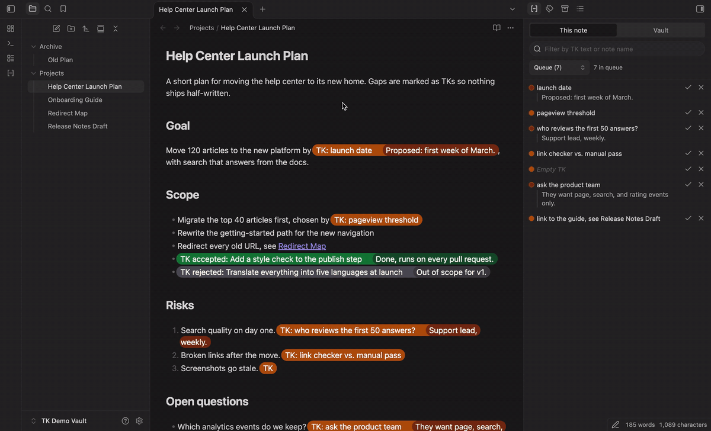

# TK Comments

An Obsidian plugin for "TK" placeholders, the writer's mark for a gap to fill later.

Write `[TK]` or `[TK: what goes here]` anywhere in a note. Add a response after ` >> `: `[TK: Is there a style guide? >> Not yet.]`. The plugin shows each one as a chip and lists every open TK in a side panel. To close one, accept or reject it from the panel, or write `[TK accepted: …]` or `[TK rejected: …]`. Delete a TK to remove it altogether.

Works on desktop and mobile.



## Features

- **Insert TK** command (`tk-comments:insert-tk`), with an icon for the mobile toolbar. Adds `[TK: ]` with the cursor inside. With text selected, that text becomes the body and the cursor lands after the `]`. There is no default hotkey; assign one in Settings > Hotkeys.
- **Live Preview chips.** Each TK shows as a solid pill shaped like the active theme's tags. The text stays in place and the brackets stay in layout, transparent, so the pill's side padding comes from them. Put the cursor on a TK and it shows raw for editing. The pill itself adds no layout shift; Obsidian still reveals its own syntax nearby, such as `**` or `]]`. Source mode gets a light highlight.
- **Reading view chips**, including TKs that contain links. Links in a chip stay clickable and render underlined in the chip's text color.
- **Side panel** with "This note" and "Vault" scopes. Vault scope groups by file, and each group collapses on its own, with a control to collapse or expand all. Open the panel from the ribbon or the **Open panel** command.
- **Row navigation.** One click opens the note, scrolls to the TK and selects it in editing view. Reading view scrolls to the line and briefly highlights it. Cmd/Ctrl-click opens a new tab.
- **Responses** show as a segment at the end of the chip, and under the comment in the panel.
- **Statuses.** Open and responded chips are amber, accepted are green and rejected are grey. Status comes from the text, so it survives sync and works without the plugin.
- **Status filter.** Queue (open plus responded, the default), Open, Responded, Accepted, Rejected or All, each with its count. The header always shows the queue count.
- **Accept, Reject and Reopen** buttons on each row rewrite only that TK's prefix. A note open in an editor changes through an editor transaction, so unsaved edits, the cursor and undo survive. Other notes use `vault.process`. If the TK has gone, or identical TKs were added or removed since the panel last updated, nothing is written and a notice says so.
- **Panel search** filters live on TK text, response text and note name, case-insensitively. Matching groups show expanded during a search, and your collapse state returns when it's cleared.
- **Excluded folders** setting, defaulting to `Archive`. Exclusions affect the panel only. Paths are relative to the vault root.

## Syntax

| Text | TK? |
| --- | --- |
| `[TK]`, `[TK: body]`, `[TK:body]`, `[TK: ]` | Yes |
| `[TK: see [[Some Note]] first]` | Yes, brackets are balanced |
| `[TK: link text]()` | Yes, a link with no destination yet |
| `[TK: comment >> response]` | Yes, with a response. Spaces on both sides are required |
| `[TK: a >> b >> c]` | Yes. The first separator splits, so the response is `b >> c` |
| `[TK: comment >> ]` | Yes, with no response yet |
| `[TK accepted: comment]`, `[TK accepted: comment >> response]` | Yes, accepted. The response is optional |
| `[TK rejected: comment]`, `[TK rejected: comment >> response]` | Yes, rejected. The response is optional |
| `[TK done: x]`, `[TK Accepted: x]`, `[TK accepted x]`, `[TK accepted]` | No. Only the exact lowercase words, with one space after `TK` |
| `[TK: a>>b]`, `[TK: a \| b]`, `[TK: [x >> y]]` | Yes, with no response |
| In YAML frontmatter | Yes in the panel, not decorated |
| `[TKO]`, `[TK-1]`, `[TKs: x]`, `[tk]` | No |
| `\[TK]`, `` `[TK]` ``, fenced code | No |
| `[[TK]]`, `[TK](https://example.com)` | No, these are links |
| `[TK: opened` and closed on a later line | No, TKs are single-line |

Limits of the parser:

- Code spans are matched within one line.
- Indented code blocks are not detected, since four spaces is also how list content nests.

## Appearance

The settings tab sets chip colors for dark and light themes separately, plus padding and font, with a reset for each section. Changes apply live, including in popout windows.

The defaults move no text when the cursor enters a TK. A different font, size, weight or a larger horizontal padding can, because the chip and the raw text then have different widths. Vertical padding never does.

Themes can also override these on `body`, and on `.theme-dark` for the dark palette. Values set in the settings tab take priority.

| Variable | Purpose | Default |
| --- | --- | --- |
| `--tk-chip-fill` | Pill fill | Amber, darker in dark themes |
| `--tk-chip-text` | Pill text and links | Near-black, white in dark themes |
| `--tk-chip-response-fill` | Response segment fill | Lighter amber, darker in dark themes |
| `--tk-chip-response-text` | Response segment text and links | Near-black, white in dark themes |
| `--tk-chip-accepted-fill`, `--tk-chip-accepted-text` | Accepted chip | Green |
| `--tk-chip-accepted-response-fill`, `--tk-chip-accepted-response-text` | Accepted response segment | Paler green, darker in dark themes |
| `--tk-chip-rejected-fill`, `--tk-chip-rejected-text` | Rejected chip | Grey |
| `--tk-chip-rejected-response-fill`, `--tk-chip-rejected-response-text` | Rejected response segment | Paler grey, darker in dark themes |
| `--tk-chip-accepted-rgb`, `--tk-chip-rejected-rgb` | Source mode tints, as `r, g, b` | Green, grey |
| `--tk-chip-bracket` | Bracket and separator color | `transparent` |
| `--tk-chip-radius` | Corner radius | The theme's `--tag-radius` |
| `--tk-chip-padding-y` | Vertical padding | 60% of the theme's `--tag-padding-y` |
| `--tk-chip-bleed` | Extra side padding, past the brackets | `0.14em` |
| `--tk-chip-margin` | Negative side margin that cancels that padding | `0.14em` |
| `--tk-chip-font-family` | Chip font | Inherited |
| `--tk-chip-font-size` | Chip font size | Inherited |
| `--tk-chip-font-weight` | Chip font weight | Inherited |
| `--tk-chip-rgb` | Panel row accent and source tint color, as `r, g, b` | Amber |
| `--tk-source-background` | Source mode highlight | Tint of `--tk-chip-rgb` |

The default fills give 5.0:1 contrast in dark themes and 9.1:1 in light themes.

## Install

From Community plugins, once TK Comments is listed: search for "TK Comments", install, enable.

From a release: download `main.js`, `manifest.json` and `styles.css` from the release page, put them in `<vault>/.obsidian/plugins/tk-comments/`, then enable the plugin in Settings > Community plugins.

## Development

Needs Node 24.

```sh
npm install
npm test
npm run build
npm run dev
```

`npm run build` typechecks and writes `main.js`.

To install into a vault, copy `.env.example` to `.env`, set `OBSIDIAN_PLUGIN_DIR`, and run `npm run install-plugin`. It copies `main.js`, `manifest.json` and `styles.css` as real files, so a synced vault carries them to other devices.

## Releasing

1. Set the new version in `manifest.json` and add it to `versions.json` with its `minAppVersion`.
2. Commit.
3. Tag the commit with the bare version, for example `0.1.1`, with no leading `v`.
4. Push the tag.

The release workflow checks the tag against `manifest.json` and `versions.json`, runs the tests and build, and publishes `main.js`, `manifest.json` and `styles.css` as release assets.

## Layout

| Path | Contents |
| --- | --- |
| `src/parser.ts` | TK parser, with no Obsidian imports |
| `src/insert.ts` | Text and cursor offset for the insert command |
| `src/tk-index.ts` | Per-file cache with debounced updates |
| `src/panel-model.ts` | Panel search, collapse logic and count labels |
| `src/status.ts` | Re-locating a TK and planning a status edit |
| `src/reveal.ts` | Scroll and selection targets for row navigation |
| `src/editor.ts` | CodeMirror 6 chips |
| `src/reading.ts` | Reading view chips |
| `src/view.ts` | Side panel |
| `src/settings-model.ts` | Settings defaults, migration and generated CSS |
| `src/settings.ts` | Settings tab |
| `src/main.ts` | Plugin wiring |

## License

MIT
